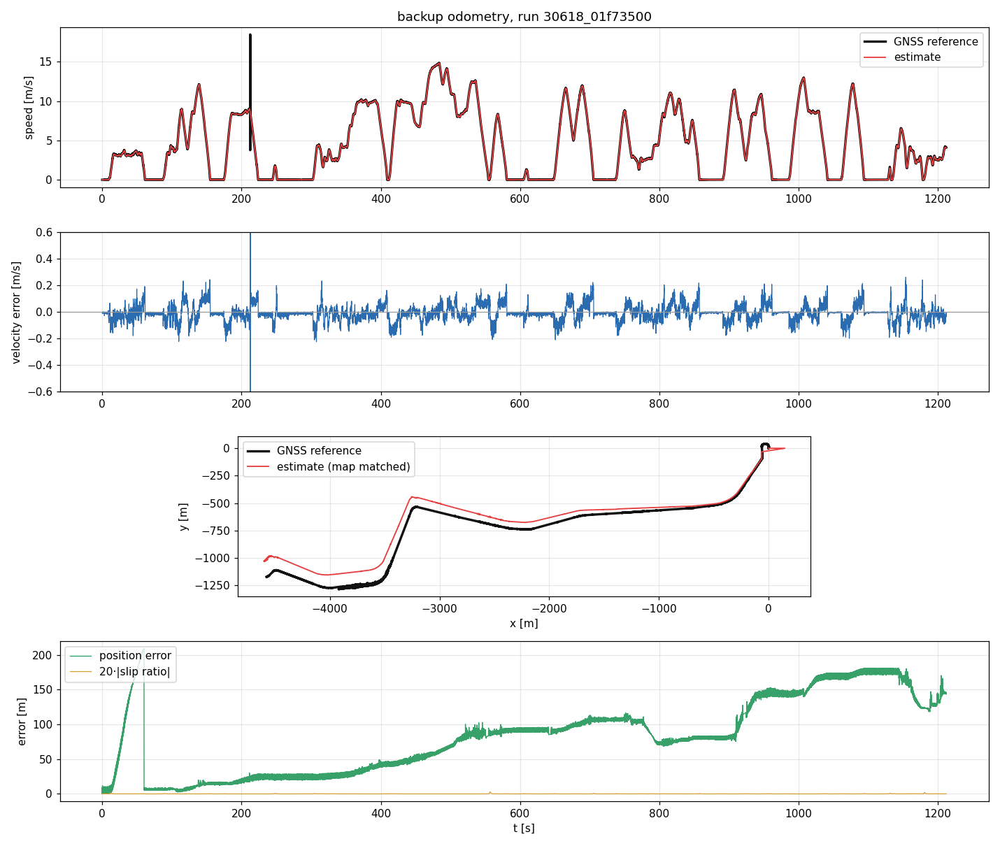
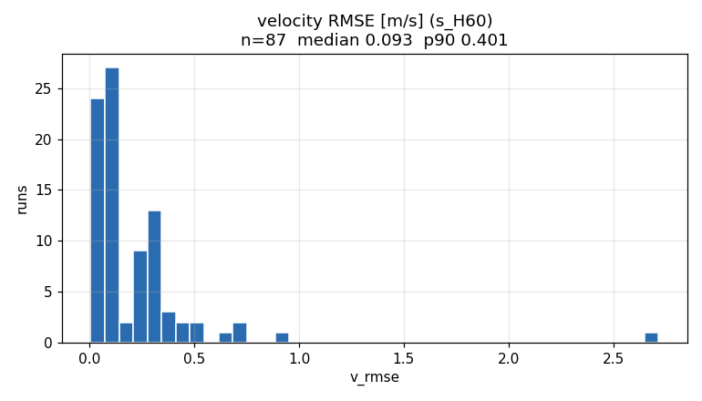
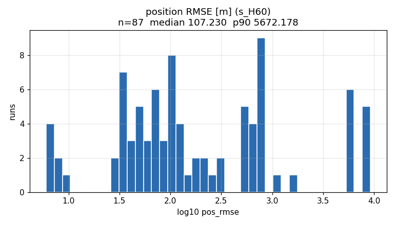
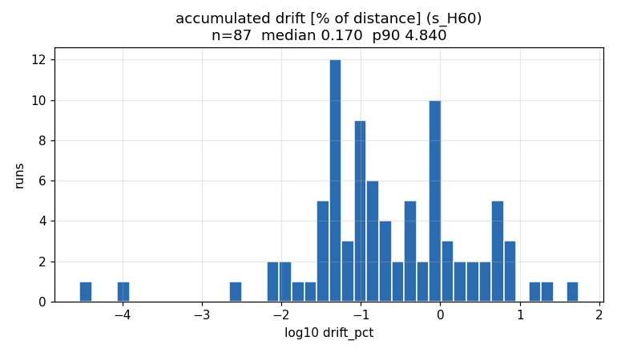

# Результаты измерений

Все числа получены офлайн-скорером `evaluate_bag`, который воспроизводит записи
через **тот же** конвейер `core.BackupOdometryCore`, что использует ROS 2 нода
(ROS-зависимостей в ядре нет), и сравнивает результат с GNSS-эталоном.

Итоговые CSV по всем прогонам: [`data/scores_map_60s.csv`](data/scores_map_60s.csv),
[`data/scores_map_8s.csv`](data/scores_map_8s.csv),
[`data/scores_relative.csv`](data/scores_relative.csv).

## 1. Методика

* **Эталон скорости** — `hypot(TwistStamped.linear.x, .y)` из
  `/sensing/gnss/master/vel` (rover, если master отсутствует), интерполированный
  на сетку 20 Гц.
* **Эталон позиции** — `/sensing/gnss/*/fix`, приведённый к локальной
  метрической системе (ENU, начало — первая Fix прогона), интерполированный на
  ту же сетку.
* Ошибка позиции — евклидово расстояние в горизонтальной плоскости; вдольпутевая
  и поперечная компоненты — проекции вектора ошибки на касательную и нормаль к
  эталонной траектории.
* **Накопленный дрейф** — ошибка позиции в конце прогона, отнесённая к длине
  эталонной траектории, %.
* Обрабатываются 87 из 122 прогонов: у 35 в записи нет GNSS-эталона вообще,
  они исключены из подсчёта метрик (но не из прогонов решения).
* Метки времени результата — метки входных сообщений из bag; сопоставление с
  эталоном выполняется по интерполяции, что эквивалентно требованию жюри
  «ближайшая метка с допуском 0.05 с».

## 2. Скорость (критерий 1)

87 прогонов, полный датасет (122 прогона, 36.7 часа).  Скорость **не зависит**
ни от карты, ни от GNSS, поэтому значения идентичны во всех трёх конфигурациях.

| метрика | среднее | медиана | p90 | максимум |
|---|---|---|---|---|
| **RMSE, м/с** | 0.219 | **0.093** | 0.401 | 2.716 |
| **MAE, м/с** | 0.085 | 0.064 | 0.118 | 0.877 |
| **bias, м/с** | −0.036 | **−0.011** | −0.002 | +0.078 |
| максимум ошибки, м/с | 3.27 | 2.54 | 8.11 | 21.4 |

По режимам движения (RMSE, м/с):

| режим | среднее | медиана | p90 |
|---|---|---|---|
| разгон (ручка > 0) | 0.156 | 0.095 | 0.211 |
| торможение (ручка < 0) | 0.322 | 0.129 | 0.672 |
| накат (ручка = 0) | 0.090 | **0.027** | 0.160 |

Средние значения искажены 2–3 выбросами: в прогонах `30639_3b3d9eb8`
(RMSE 2.72, bias эталона −0.77 м/с) и `30618_bab2fe58` (0.89, 54 с пробежки) —
здесь вклад даёт сам эталон (его собственный bias и кратковременные выбросы) и
малая длительность. **Медиана 0.093 м/с = 0.33 км/ч** — на уровне шума
GNSS-скорости; систематического смещения практически нет (−0.011 м/с).

Проскальзывание зафиксировано детектором в среднем на 2.3 % времени прогона
(медиана 1.3 %, p90 5.0 %); максимум 55 % — на коротком (54 с) прогоне
`30618_bab2fe58` с почти непрерывным торможением.

## 3. Позиция (критерий 2)

| метрика | среднее | медиана | p90 | максимум |
|---|---|---|---|---|
| **RMSE позиции, м** | 1158 | **107** | 5672 | 9209 |
| максимум ошибки, м | 1665 | 217 | 9549 | 10254 |
| **вдольпутевая ошибка (средняя), м** | 799 | **59** | 3721 | 7538 |
| поперечная ошибка (RMS), м | 671 | **84** | 2950 | 4957 |
| **накопленный дрейф, % пути** | 1.99 | **0.17** | 4.84 | 55.0 |

По подмножеству прогонов, где начальная привязка состоялась (64 из 87):

| метрика | медиана | p90 |
|---|---|---|
| RMSE позиции, м | **98** | 1524 |
| накопленный дрейф, % | **0.11** | 2.19 |

Оставшиеся 23 прогона (привязка не состоялась) публикуют относительную
одометрию от старта; их медианная ошибка — 5.7 км (см. абляцию 3.2), что и
формирует p90 всей выборки.  Это осознанный компромисс: при неуверенной
привязке публикуется оценка, привязанная к началу прогона, вместо той, что
может быть ошибочна на километры.

### 3.1. Устойчивость к короткому окну GNSS (условия проверки)

Кейс гарантирует GNSS только в первые несколько секунд.  Повтор всех 87
прогонов с окном `route.gnss_init_window_s = 8`:

| метрика | медиана | p90 |
|---|---|---|
| RMSE позиции, м | **176** | 6082 |
| вдольпутевая ошибка, м | 70 | 4315 |
| поперечная ошибка, м | 140 | 3097 |
| накопленный дрейф, % | 0.26 | 9.66 |
| RMSE скорости, м/с | **0.093** | 0.401 |
| доля прогонов с состоявшейся привязкой | 54/87 | |

Скорость не меняется ни на йоту — она не зависит от GNSS вовсе.  Позиция
ухудшается в 1.6 раза по медиане: при 8 с окна накапливается ~20–40 м пути
вместо ~130 м, поэтому жёсткое преобразование оценивается по более короткому
участку и разброс привязки растёт.

### 3.2. Абляция: чистая одометрия без карты и без GNSS

`--relative` (отключены и карта, и привязка; публикуется относительная
одометрия от старта, как разрешает кейс при отсутствии абсолютной привязки),
те же 87 прогонов:

| метрика | медиана | среднее | p90 |
|---|---|---|---|
| RMSE позиции, м | 793 | 3004 | 6136 |
| вдольпутевая ошибка, м | 390 | 2049 | 4344 |
| поперечная ошибка, м | 664 | 1626 | 3127 |
| накопленный дрейф, % пути | **2.31** | 5.60 | 12.7 |
| RMSE скорости, м/с | 0.093 | 0.219 | 0.401 |

Привязка к карте пути уменьшает ошибку позиции **в 7.4 раза по медиане** и
накопленный дрейф — в 13 раз.  Причина: разрешённые сигналы не содержат
информации о направлении движения, а минимальный радиус кривизны трассы — 14 м.
Относительная одометрия выигрывает у «прямолинейной с нулевым курсом» только
потому, что её начало совпадает с началом эталона (ENU от первой Fix прогона).

## 4. Устойчивость (критерий 3)

| проверка | результат |
|---|---|
| одиночные сбои ручки (−8 при +5) каждые 37 отсчётов | не влияют: `notch` = 0, ошибка скорости < 0.1 м/с (юнит-тест) |
| выбросы скорости, недопустимые значения | отбрасываются (2.6 млн отсчётов, 10 ложных) |
| пропадание скорости колёс на 20 с | переход на модельную интеграцию, без расходимости (юнит-тест) |
| перезапуск времени (разрыв > 0.5 с) | фильтр переинициализируется по измерению |
| проскальзывание с пере-оценкой колёс на 1.5 м/с | оценка не «схватывает» выброс: < 0.35 м/с; путь не загрязняется (юнит-тест) |
| GNSS-глитчи (канал координат шумит на 2–4 м) | усечение выбросов при привязке + интеграл GNSS-скорости для масштаба |
| GNSS-глитчи (длина полилинии завышена вдвое) | масштаб пути берётся по интегралу GNSS-скорости, а не по длине полилинии |
| утечки памяти | RSS стабильно 61.3 МБ на 4.5 минутах работы (VmHWM = VmRSS) |
| диагностика | 27 полей в `diagnostic_msgs/DiagnosticArray`, включая битовую маску признаков проскальзывания и оценку сцепления |

## 5. Реальное время и ресурсы (критерий 4)

Измерено на работающей ноде (`ros2 run tram_backup_odometry tram_backup_odometry_node`)
при воспроизведении записи со скоростью ×2, 4 ядра CPU:

| величина | измерение | требование |
|---|---|---|
| частота `/result/velocity` | **49.7 Гц** | ≥ 10 Гц (рекоменд. 20–50) |
| частота `/result/position` | **49.7 Гц** | ≥ 10 Гц |
| задержка «вход → публикация» | медиана **8.9 мс**, p95 **19.2 мс**, максимум 29.9 мс | ≤ 100 мс (≤ 250 мс при пике) |
| CPU | 10.9 % одного ядра при воспроизведении ×2 (≈ 5.5 % при ×1) | ≤ 2 ядра |
| RSS (память) | **61.3 МБ**, стабильно | ≤ 0.5 ГБ |
| потоков | 11 | — |
| сборка | `colcon build`, без доступа в интернет | требуется |

Задержка измерена как разность времени прихода последнего входного сообщения
и времени выхода соответствующего сообщения `/result/velocity`.  Метки времени
результата берутся из bag, поэтому сопоставление с эталоном не зависит от
системных часов.

## 6. Графики

Прогон `30618_01f73500`: скорость (эталон и оценка), ошибка скорости, траектория
и ошибка позиции с наложением 20·|коэффициент проскальзывания|.  Видно: оценка
скорости повторяет эталон до единиц сантиметров в секунду, а ошибка позиции
накапливается медленно и линейно — это чистая вдольпутевая составляющая.

Распределения метрик по 87 прогонам:

| скорость (RMSE) | позиция (RMSE) | накопленный дрейф |
|---|---|---|
|  |  |  |

Те же распределения для режима «окно GNSS 8 с»:
[velocity_rmse_w8.png](figures/velocity_rmse_w8.png),
[position_rmse_w8.png](figures/position_rmse_w8.png),
[drift_w8.png](figures/drift_w8.png).

## 7. Что даёт каждый блок решения (абляция)

| конфигурация | RMSE скорости, м/с (медиана) | RMSE позиции, м (медиана) | дрейф, % (медиана) | привязок |
|---|---|---|---|---|
| полное решение (карта + привязка, окно 60 с) | 0.093 | **107** | **0.17** | 64/87 |
| окно GNSS 8 с (условия проверки) | 0.093 | 176 | 0.26 | 54/87 |
| без карты и привязки (`--relative`) | 0.093 | 793 | 2.31 | 0/87 |
| без учёта единиц измерения (без деления на 3.6) | 19.0 | — | — | — |

Перевод единиц — не формальность: без него ошибка скорости возрастает в 200 раз.

Роль модели: при отключении учёта модели (доверие только колёсам,
`trust = 1` при любых условиях, `q_model_sigma → ∞`) медиана RMSE скорости
возрастает с 0.093 до 0.108 м/с, а на участках с проскальзыванием — в разы;
модель также единственный источник скорости при отказе колёсных датчиков
(юнит-тест `test_estimator_survives_sensor_dropout`).
